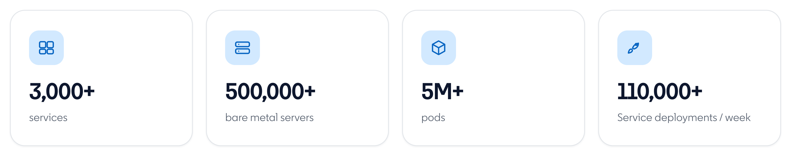
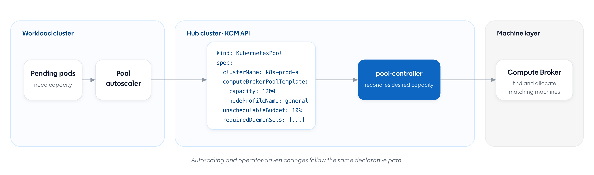
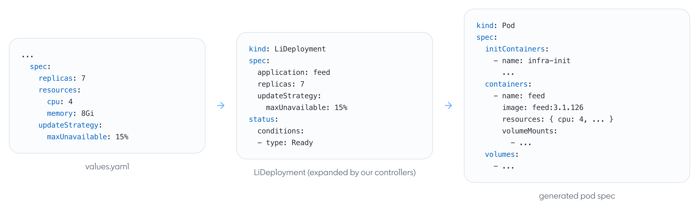
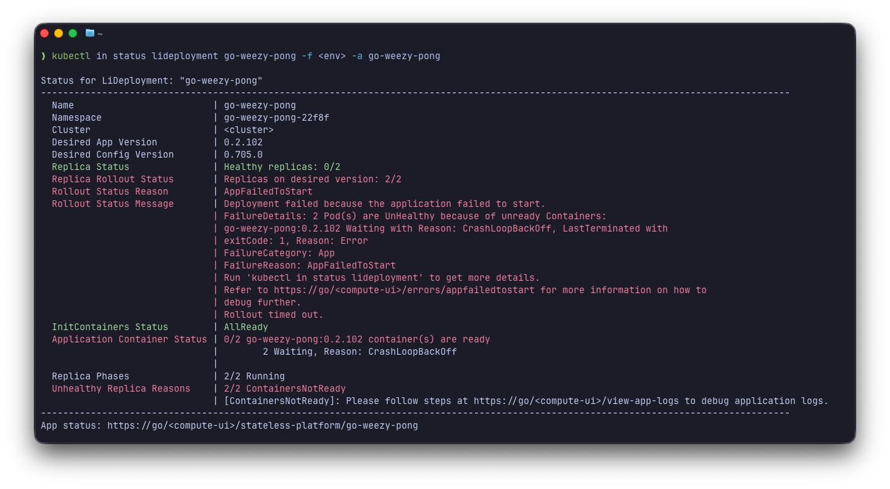
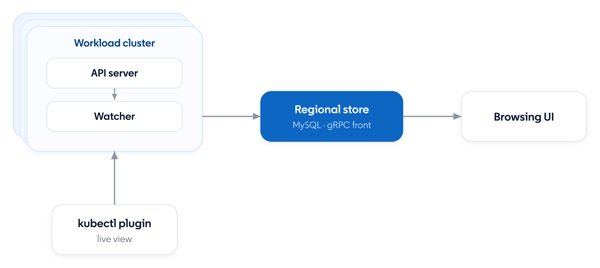

import CNCFProjectCard from '@site/src/components/CNCFProjectCard';

> Submitted by LinkedIn to the CNCF End User Technical Advisory Board. Documentation is distributed under [CC BY 4.0](https://creativecommons.org/licenses/by/4.0/).

## Relevant CNCF projects

<CNCFProjectCard name={"Kubernetes"} href={"https://www.cncf.io/projects/kubernetes/"} logo={"/img/cncf-projects/kubernetes-kubernetes-icon-color.svg"} since={"2019"} version={"1.34+"} description={"We self-manage open source Kubernetes on bare metal hosts. We provision and operate clusters with our own tooling rather than `kubeadm`, Cluster API, `kops`, or a vendor distribution. We run N-2 relative to the latest upstream release, with clusters around 6,000 nodes."} />

<CNCFProjectCard name={"etcd"} href={"https://www.cncf.io/projects/etcd/"} logo={"/img/cncf-projects/etcd-etcd-icon-color.svg"} since={"2019"} description={"etcd is the first control-plane component that needs attention as clusters grow. We run it on fast SSDs with a 32 GiB backend quota and have run that configuration in production for more than a year. We maintain our own backup and restore system for recovery."} />

<CNCFProjectCard name={"containerd"} href={"https://www.cncf.io/projects/containerd/"} logo={"/img/cncf-projects/containerd-containerd-icon-color.svg"} description={"containerd is the container runtime on every node. Our host agent configures kubelet and containerd when a machine joins a cluster, and container runtime upgrades roll through the same maintenance-zone and disruption paths as kubelet."} />

<CNCFProjectCard name={"Helm"} href={"https://www.cncf.io/projects/helm/"} logo={"/img/cncf-projects/helm-helm-icon-color.svg"} since={"2019"} description={"Every application fills in a `values.yaml` on a base Helm chart we maintain. The values render into our workload custom resources. The chart gives us one consistent shape to build validation and API evolution against."} />

<CNCFProjectCard name={"cert-manager"} href={"https://www.cncf.io/projects/cert-manager/"} logo={"/img/cncf-projects/cert-manager-cert-manager-icon-color.svg"} description={"We extend cert-manager with our PKI, fleet-wide identity, and approval integrations, rather than running it as a standalone, cluster-scoped identity system."} />

<CNCFProjectCard name={"Fluent Bit"} href={"https://www.cncf.io/projects/fluentd/"} logo={"/img/cncf-projects/fluentd-fluentbit-icon-color.svg"} description={"Fluent Bit runs on our hosts as part of observability. Metrics, logs, and traces go to centralized storage rather than per-cluster systems."} />

<CNCFProjectCard name={"gRPC"} href={"https://www.cncf.io/projects/grpc/"} logo={"/img/cncf-projects/grpc-grpc-icon-color.svg"} since={"2019"} description={"Our machine layer is built as gRPC services, reconciliation daemons, and databases, with no Kubernetes in it. Compute Broker, our machine-as-a-service API, is one of those gRPC services."} />

<CNCFProjectCard name={"Kyverno"} href={"https://www.cncf.io/projects/kyverno/"} logo={"/img/cncf-projects/kyverno-kyverno-icon-color.svg"} since={"2022"} description={"We use Kyverno as a policy engine to enforce cluster-wide guardrails and validate resources at admission across the fleet, alongside the custom admission webhooks we run for user-facing custom resources."} />

<CNCFProjectCard name={"OpenTelemetry"} href={"https://www.cncf.io/projects/opentelemetry/"} logo={"/img/cncf-projects/opentelemetry-opentelemetry-icon-color.svg"} />

<CNCFProjectCard name={"Argo"} href={"https://www.cncf.io/projects/argo/"} logo={"/img/cncf-projects/argo-argo-icon-color.svg"} />

<CNCFProjectCard name={"Envoy"} href={"https://www.cncf.io/projects/envoy/"} logo={"/img/cncf-projects/envoy-envoy-icon-color.svg"} />

<CNCFProjectCard name={"SPIFFE"} href={"https://www.cncf.io/projects/spiffe/"} logo={"/img/cncf-projects/spiffe-spiffe-icon-color.svg"} />

## TLDR; Synopsis

This reference architecture describes how LinkedIn runs compute on Kubernetes.
We self-manage open source Kubernetes on bare metal hosts in our own data centers, with
clusters around 6,000 nodes. We use Kubernetes as a primitive, and we designed
fleet management and workload management as one system. Workload owners express
their capacity and availability requirements. The platform handles placement,
provisioning, maintenance, and infrastructure lifecycle.

Most application teams don't consume core Kubernetes APIs like Deployments,
StatefulSets, Services, Ingress, Secrets, or ConfigMaps. They use a small set of
APIs exposed by curated platforms we build on top, so an app developer can ship a
service safely and quickly without knowing the intricate details of Kubernetes.

The fleet it serves is large:

In particular, this architecture targets:

- **Fleet and workload management as one system.** The workload layer approves
  each machine disruption, so maintenance proceeds only when the affected
  workloads keep their availability. We update the entire fleet of bare metal
  machines without human intervention in less than 30 days.
- **Kubernetes as a primitive, kept simple at scale.** Our Kubernetes footprint is
  large, and we work hard to keep it simple. We limit what runs as a cluster
  add-on, evaluate every dependency against our scale and failure modes, and
  build an alternative in-house when an off-the-shelf component doesn't fit.
- **Cluster, namespace, and machine abstraction.** A team's job is to describe
  its workload. Where it physically lands is the platform's concern.
- **Fungible compute.** If a team has quota, we deliver compute for its workloads
  on the hardware its node profile describes, and we choose where it runs.
- **Best practices by default.** Disruption budgets, spread across maintenance
  zones, and integration with LinkedIn's PKI, service discovery, configuration,
  observability, and network policy. No application team wires any of it up.

## Organization

LinkedIn is the world's largest professional network, with more than a billion
members. Behind the product is a large engineering organization and one of the
biggest private, bare-metal compute footprints in the industry: 500,000+ servers
running 5M+ pods across multiple data centers.

We run our own data centers, with no cloud provider and no virtualization layer,
so we build and operate much of what a managed Kubernetes offering would provide.
With thousands of engineers, we'd rather solve each hard problem once, centrally,
than have every team solve it approximately on its own.

## Teams

The compute platform is built and operated by LinkedIn's Compute organization.
Responsibility is split roughly along the three architectural layers:

**Infrastructure as a Service** owns the machine layer: inventory, Compute
Broker, the Quota Ledger, host health monitoring and remediation, and the
Maintenance Orchestrator.

**Kubernetes Cluster Management (KCM)** owns clusters, pools, nodes, the control
plane, upgrades, and the controllers that manage their lifecycle.

**Workload platforms** own the developer-facing APIs, the controllers that manage
workload lifecycle, deployment orchestration, and the exploration and
troubleshooting tools.

## Architecture

### Architecture Overview

The platform is built in three layers.

![LinkedIn's three-layer compute platform. Workload platforms: Deployment Orchestration Service (onboarding, rollout, history), Compute Platform UI (exploration, health, troubleshooting), stateless platform (LiDeployment), stateful platform (LiStatefulSet), jobs platform (Spark, ML, CI, Airflow), and Kubernetes-as-a-service (Flink, DB-as-a-service). Kubernetes cluster management: Kubernetes clusters with pools, cluster/pool/node lifecycle controllers, and workload placement. Infrastructure as a Service: datacenter inventory manager, Compute Broker, Quota Ledger, host health monitoring and remediation, and maintenance orchestrator.](./images/linkedin-compute-platform-layers.png)

1. **Infrastructure as a Service.** The machine and data center layer, built as
   gRPC services, reconciliation daemons, and databases. There's no Kubernetes in
   this layer.
2. **Kubernetes Cluster Management (KCM).** Clusters, pools, nodes, and the
   controllers that manage their lifecycle.
3. **Workload platforms.** The developer-facing APIs, controllers that manage
   workload lifecycle, deployment orchestration services that manage rollouts,
   and workload exploration and troubleshooting UIs.

The bottom two layers let us run Kubernetes on bare metal hosts at this scale. The top
layer gives us one place to solve workload-management problems for the majority
of cases.

#### Layer 1: the machine layer, before any Kubernetes

- **Inventory Manager** stores the hardware and topology of every machine.
- **Compute Broker** is our machine-as-a-service API. For anyone coming from a
  cloud provider, it plays the role of a VM scale set or an autoscaling instance
  group API. It manages pools of machines, lets us add or remove capacity, and is
  the source of truth for machine allocation and maintenance. Every machine that
  isn't a spare is part of a pool. A pool is made up of heterogeneous but
  interchangeable hardware, and each pool declares a **node profile**: the minimum
  machine requirement (SKUs plus configuration) that any machine in the pool has
  to satisfy. That same node profile is how a workload asks for compute, instead
  of asking for specific SKUs or arbitrary label selectors.
- **Quota Ledger** tracks allocated and consumed compute across the
  organizational hierarchy. It supports quota transfers and provides the
  accounting used by capacity planning and forecasting. Workload admission checks
  this quota before a rollout starts.
- **Host health monitoring and remediation** automatically detect, remove, and
  repair unhealthy machines.
- **Maintenance Orchestrator (MO)** schedules planned, fleet-wide work such as
  operating system, kubelet and containerd, firmware, and top-of-rack switch
  upgrades. MO coordinates the operation, while specialized systems perform the
  actual reimage, firmware, or network updates.

##### Maintenance zones

A maintenance zone (MZ) is a software update domain. We stripe each data center
into 20 maintenance zones. Fleet-wide changes, like OS, kernel, kubelet, and
containerd changes, go through staged validation, then roll through production
one MZ at a time. If a change causes failures, we can stop after one zone and
limit the affected capacity to about 5% of a data center.

Compute pools are striped evenly across the maintenance zones. The workload
platform uses topology labels and spread constraints to place a workload's pods
across zones, and the app owner never asks for it. Disrupting one zone leaves
enough capacity and replicas in the others for workloads to keep serving.

##### Disruptions: one protocol for planned and unplanned maintenance

Whether a request comes from MO or from host health remediation, it enters the
same protocol: a **disruption**, brokered by Compute Broker. A disruption
transfers control of a machine from Kubernetes to a maintenance actor and back.

The flow is a handshake. A maintenance actor schedules a disruption on a machine
in Compute Broker and waits for approval. Each node has disruption handlers
registered for each workload type, stateless and stateful. KCM asks the handlers
whether the node can be cordoned. Once they approve, KCM cordons the node. Each
handler drains the workloads it owns and records its approval. KCM aggregates
those approvals and transfers control to the maintenance actor. The actor updates
or repairs the machine and marks the disruption complete, which returns control
to Kubernetes and puts the node back into rotation. Only one disruption can be
approved for a machine at a time.

The handler model makes the protocol workload-aware. The stateless handler drains
pods with the Kubernetes eviction API, which honors `PodDisruptionBudget`s and
eviction webhooks. The stateful handler checks with the data system's
Application Cluster Manager (ACM) before draining a pod. A node can run both
workload types, and maintenance proceeds only after every handler agrees. Each
pool's unschedulable-capacity budget also caps how many of its nodes can be
cordoned at once. The figure shows the paths for unreachable nodes and healthy
decommissions.

#### Layer 2: running large Kubernetes clusters

**We prefer clusters around 6,000 nodes and keep pushing beyond that size.**
Large clusters reduce capacity fragmentation, give workloads room to grow, and let
stateless, stateful, and batch workloads share capacity. They also reduce control
plane cost and operational overhead. We manage hundreds of clusters, so we'd
rather run hundreds of large ones than thousands of small ones. A central hub
cluster runs the KCM controllers, one per region, and places each application on
a workload cluster.

##### Running and scaling the control plane

Each production control plane runs on stable hosts outside Kubernetes under our
own orchestration. We package the open source control-plane components and
deploy them with our own stack. We keep the control plane stable by limiting
what runs as a cluster add-on. We review the RBAC of every operator a team brings
in to bound its blast radius, and we use API Priority and Fairness to keep one
client from starving the others.

etcd is the first control-plane component that needs attention as clusters grow.
Upstream guidance commonly recommends an 8 GiB backend quota. In our experience,
that recommendation is more relevant to slower disks. We run etcd on fast SSDs
with a 32 GiB backend quota, and we've run that configuration in production for
more than a year. It's been stable throughout.

Other control-plane components and many of our controllers are memory-bound
because they keep large object caches, specifically of pods. We optimize our
controllers' informer caches and give these components the memory they need.

We run Kubernetes at N-2 relative to the latest upstream release. Control-plane
components upgrade through rolling deployment. For skip-level upgrades, we use
the control plane's
[emulated version](https://kubernetes.io/docs/concepts/cluster-administration/compatibility-version/)
(`--emulated-version`), which lets a newer binary behave like an earlier
Kubernetes release. Our KubeCon NA 2026 talk,
[*Binary Version Is Not Behavior*](https://www.youtube.com/watch?v=HS_gEo7shLA),
walks through how we do this across the fleet. Kubelet and container runtime
upgrades use the maintenance-zone and disruption paths described above.

##### Pools are declarative and autoscaled

Each `KubernetesPool` represents a pool in Compute Broker, with static
configuration and autoscaling bounds declared in git. The pool autoscaler watches
pending pods and updates desired capacity within those bounds, and the pool
controller reconciles that intent to Compute Broker. This redistributes finite
capacity rather than creating new hardware. A machine already prepared for the
requested node profile can join in under 2 minutes.

##### How a machine joins a pool and cluster

KCM creates a `KubernetesNode` object with the machine's join configuration, and
the host agent uses it to configure kubelet and containerd. The node joins with a
startup taint, so application pods aren't admitted until Compute Broker marks the
machine allocated and the required DaemonSets are ready.

#### Layer 3: curated workload platforms

We expose Kubernetes through four offerings: a **stateless** services platform, a
**stateful** services platform, a **jobs** platform, and
**Kubernetes-as-a-service**. Measured by CPU allocation, about 80% of our compute
is stateless and stateful services, roughly 5% is jobs, and the remaining 15% is
Kubernetes-as-a-service.

Stateless and stateful workloads use two custom resources, **`LiDeployment`** and
**`LiStatefulSet`**. Application teams can create and update only these platform
APIs. They get no direct permissions to create or mutate native Kubernetes
resources. The jobs platform (AI training, Spark, CI) and Kubernetes-as-a-service
(platform teams like Flink or database-as-a-service) have their own access
models. The rest of this section focuses on the stateless and stateful platforms.

##### Quota, placement, and relocation

A namespace and a cluster are implementation details, and a developer doesn't
pick either one. They request compute for their application, and the platform
decides which cluster, pool, and machines satisfy it. Quota is checked at
admission time. A rollout that asks for more than the team's quota fails right
away with a clear reason instead of getting stuck halfway. A rollout within quota
may still wait while Compute Broker prepares matching bare-metal capacity.

Placement is transparent and mutable. The platform picks where a workload runs
when it first onboards. We relocate stateless applications between clusters to
defragment capacity, consolidate, or drain a cluster for decommission. Moving a
stateful system is a data operation, so it's coordinated deliberately through
its ACM rather than used for routine defragmentation. Application traffic isn't
affected by cluster boundaries, because our service discovery is global and
cluster-agnostic. A separate service tracks each app's placement, so clients like
our deployment system and internal `kubectl` plugin can find the right cluster.

##### Regional and global platform integrations

For the 80% case, application workloads don't consume several core Kubernetes
APIs. These features work well within a cluster but get expensive and complex
across a fleet of them, and we already operate hardened equivalents with regional
or global scope:

| Capability | Common Kubernetes approach | What we use |
| :---- | :---- | :---- |
| Service discovery | Services + DNS | xDS-based discovery with global scope, independent of cluster placement |
| Config and secrets | ConfigMap / Secret | Home-grown services that manage configuration and secrets at regional scope across runtimes |
| Identity | cert-manager | cert-manager extended with our PKI, fleet-wide identity, and approval integrations |
| Network policy | NetworkPolicy enforced by the CNI | Policy managed globally and enforced by our on-host agent |
| Observability | Prometheus | Fluent Bit on hosts, with metrics, logs, and traces in centralized storage |

For stateless and stateful workloads, Kubernetes gives us the infrastructure to
build declarative APIs and reconciliation loops. We integrate those APIs with the
regional and global systems we already run instead of adopting parallel,
cluster-scoped systems.

##### From application intent to a running pod

Users don't write raw Kubernetes manifests, and they don't pick node selectors.
They choose compute through a node profile and fill in a `values.yaml` on a base
Helm chart we maintain. Those values render into a `LiDeployment` or
`LiStatefulSet`, which our controllers expand into a full pod spec, injecting
init containers, default volume mounts, and environment variables per our
container runtime contract.

This standardization gives us one surface for validation and API evolution. The
same validation runs before merge and at admission. If a pull request omits a
required field such as memory, a GitHub Action reports the error before the
request reaches production.

##### How a deployment happens

On the first deployment, a controller on the hub cluster selects a cluster and
matching pool, creates the namespace, and turns ownership rules from our global
authorization service into role bindings. On every deployment, a rollout pod
applies the manifests and watches the workload custom resource's top-level
`Ready` condition and `observedGeneration`, rather than interpreting every
underlying Kubernetes object. A failed rollout reports whether the problem is in
the application or the infrastructure, and that status is shared across the
deployment UI, command-line tools, and automation.

##### Stateful, without asking teams to learn Kubernetes

We run a lot of distributed stateful systems, like Kafka, Pinot, Ambry, and
Venice. They store data on local disk for performance, and they're sharded and
replicated, so any pod eviction or update needs coordination.

A generic Kubernetes `StatefulSet` can manage pod identity and do ordered updates,
but it doesn't know whether removing a replica leaves every shard with enough
healthy copies. It also doesn't coordinate application-aware host maintenance.

So we inverted the usual model. Instead of a bespoke operator per system, every
stateful application shares one generic operator and uses the `LiStatefulSet`
API. The application-specific safety logic lives in a pluggable policy engine
called the Application Cluster Manager (ACM). Before the operator creates,
deletes, drains, or swaps a pod, it asks the ACM whether the action is safe, and
proceeds only when the ACM says yes. The data system owns its safety invariant,
and the platform owns the common lifecycle and maintenance protocol. This same
interface lets infrastructure maintenance make progress without embedding the
logic for every data system in KCM.

## Can you expand on why you are using those projects/services?

Each card above covers how we use a project. The common thread is fit for a
fleet of large clusters on bare metal hosts:

- **Kubernetes** gives us declarative APIs and reconciliation loops to build our
  own platform APIs on, without adopting its cluster-scoped features wholesale.
- **etcd** sets the ceiling on cluster size, so it's where we invest first.
- **cert-manager** gives every pod an identity, and its extension points let us
  plug in our own PKI.
- **Fluent Bit** gives every pod observability, and its extension points let us
  send telemetry to our own centralized storage.
- **Helm** gives every application the same shape, so we validate and evolve
  workload APIs in one place.
- **gRPC** keeps the machine layer independent of the Kubernetes API.

## What works particularly well

- **Fleet and workload management as one system.** The whole fleet gets updated
  without human intervention in less than 30 days.
- **A curated platform as the default path.** Disruption budgets, zone spread,
  and PKI, service discovery, configuration, and observability integrations come
  for free. App owners get safe behavior without reasoning about it.
- **Reliability at the deployment layer.** For stateless services, 99.9% of
  deployment attempts reach a terminal state without an infrastructure-attributable
  failure. That metric excludes application-health failures, so it measures the
  deployment infrastructure, not whether the app became healthy.
- **Transparent relocation of stateless apps.** We defragment, consolidate, and
  drain clusters without affecting traffic.
- **A generic stateful operator.** Kafka, Pinot, Ambry, and Venice run on
  Kubernetes without every team learning it or writing its own operator.
- **Large clusters on a single etcd.** A 32 GiB backend quota on fast SSDs has
  been stable in production for more than a year.

## What needs improvement

- **An application is bound to a single cluster.** It can't grow past one
  cluster, and its availability is tied to that cluster. When an app gets close to
  the cluster's size limit we have to relocate it to another cluster. That
  relocation is toil we'd rather not carry.
- **Stateless and stateful are separate APIs.** Many workloads live on a
  spectrum, especially AI inference. Moving a workload from one end to the other
  means moving it between the two APIs. Some workloads just want a best-effort
  cache with rolling updates, so they sit in between and don't map cleanly to
  either.
- **One version at a time per deployment.** Applications want to run multiple
  versions at the same time and gradually move replicas from one version to
  another. Today that means managing multiple deployments.

The multi-cluster, composable APIs we're building (covered in What's next) are
our answer to all three.

## What sort of "glue" have you had to develop?

Most of our engineering is the surrounding machinery that keeps the fleet simple
and scalable. The first few pieces are covered in the architecture above:

- **Machine layer.** Compute Broker, the Quota Ledger, and the Maintenance
  Orchestrator.
- **KCM controllers.** Pool, node, and cluster lifecycle, the pool autoscaler, the
  `KubernetesNode` join flow, the host agent, and the disruption-handler protocol.
- **Deployment Orchestration Service (DOS).** Orchestrates a rollout from staging
  through multiple production environments, with canary analysis and validation
  at each step. Each step creates a rollout pod.
- **Actionable failures.** Rollout status tags each failure as an app issue or an
  infra issue in plain language, and the same status shows up in the rollout UI
  and our troubleshooting tools.

  

The rest is the operating experience every workload gets by default:

- **Rollout and intent history.** Users can see every action that changed a
  workload's spec, whether it came from a person or an automated system like the
  autoscaler, and the outcome. That's the audit trail for what changed, when, and
  by whom.
- **Internal `kubectl` plugin.** Standard `kubectl` access remains for resources
  users can read, but the plugin is the primary entry point. Its status,
  exploration, and troubleshooting commands are app-centric. Users ask about an
  application, and the plugin resolves the right cluster and namespace and routes
  the request.
- **Regional read store.** A per-cluster watcher streams custom-resource, pod, and
  node fields into a MySQL-backed, gRPC-fronted store. A separate UI reads it for
  browsing and troubleshooting, which keeps that traffic off the API servers. The
  `kubectl` plugin reads live from the cluster.

  
- **Production guardrails.** Delete protection for every user-facing resource,
  non-empty namespaces, and CRDs still in use. Caps on how much a workload can
  scale down in one action, and on surge and canary percentages.
- **Observability by default.** Every application gets standard metrics, logs,
  alerts, and a dashboard with no setup. Default alerts go to the application's
  on-call, and teams tune them as needed.

## How did the Architecture Evolve

- **From a homegrown stack to Kubernetes.** More than a decade ago, LinkedIn built
  its own container runtime and scheduler. Docker was still new and Kubernetes
  wasn't yet mature. That stack served us well for years, but it became hard and
  expensive to evolve, and AI and ML workloads brought requirements it wasn't
  built for. We began adopting Kubernetes several years ago, and today most
  LinkedIn workloads run on it.
- **A centrally driven migration.** We automated the common stateless path and
  challenged legacy requirements instead of carrying them all forward.
  Applications ran on both platforms during the transition, because service
  discovery, identity, configuration, and observability sit above the scheduler.
  More than 95% of the scoped stateless, stateful, and batch migration is now
  complete.
- **One etcd cluster per Kubernetes cluster.** We tested a separate etcd cluster
  for Events, but the performance gain didn't justify another cluster to operate
  for every Kubernetes cluster.
- **Two systems for two questions.** We separate "did my rollout finish and
  succeed?" (orchestration and history) from "is my app healthy right now?" (live
  state), because they're different questions.

## What's next for your architecture?

- **Multi-cluster, composable APIs.** This is the big investment, and it answers
  all three challenges above. Federating a workload across clusters improves
  utilization, removes the single-cluster ceiling and the relocation toil, and
  limits a rollout's blast radius to one cluster. Serving stateless and stateful
  through one custom resource with different update strategies lets a workload
  change its operational model without switching platforms. That matters most for
  AI inference, which rarely sits cleanly at either end. The same APIs let an
  application run multiple versions side by side and gradually shift replicas
  from one version to another, without managing multiple deployments. We covered
  this design at KubeCon NA 2026 in
  [*Beyond Stateless vs Stateful*](https://www.youtube.com/watch?v=7zrHM5P0cCk).
- **Larger clusters.** We're continuing to push individual clusters beyond 6,000
  nodes. Our scale and availability tests show headroom beyond the current size.
- **Control planes as pods.** For test clusters, we're running control planes as
  pods, and we may eventually use that model for production.

## Key Takeaways / Lessons

- **Design fleet management and workload management as one system.** Letting the
  workload layer approve each machine disruption is what makes a fully automated,
  fleet-wide update safe.
- **Be selective and informed about what you adopt from open source.** Evaluate
  every dependency against your scale and failure modes. When a component clears
  that bar, it works out well. When it doesn't, building your own lets you control
  your fate.
- **Shape Kubernetes for your engineers rather than passing it through.** For us
  that meant a curated platform where clusters, namespaces, and machines are
  abstracted away, and a team's job is just to describe its workload.

## Further reading

- Blog: [*How LinkedIn Runs Compute: Self-Managed Kubernetes on 500,000+ Bare-Metal Servers*](https://www.linkedin.com/blog/engineering/infrastructure/how-linkedin-runs-compute-self-managed-kubernetes-on-500000-bare-metal-servers)
- Blog: [*How LinkedIn moved its Kubernetes APIs to a different API group*](https://www.linkedin.com/blog/engineering/infrastructure/how-linkedin-moved-its-kubernetes-apis-to-a-different-api-group)
- Blog: [*Stateful Workload Operator: Stateful Systems on Kubernetes at LinkedIn*](https://www.linkedin.com/blog/engineering/infrastructure/stateful-workload-operator-stateful-systems-on-kubernetes-at-linkedin)
- Blog: [*How we scale deployments with a custom GitOps engine*](https://www.linkedin.com/blog/engineering/infrastructure/how-we-scale-deployments-with-a-custom-gitops-engine)

KubeCon + CloudNativeCon North America 2026:

- [*Beyond Stateless vs Stateful: A Unified Workload API for Multi-Cluster Kubernetes*](https://www.youtube.com/watch?v=7zrHM5P0cCk)
- [*Binary Version Is Not Behavior: Skip-Level Kubernetes Control Plane Upgrades With KEP-4330*](https://www.youtube.com/watch?v=HS_gEo7shLA)
- [*The Promises We Keep at Scale: A Contract-Driven Guide to Platform SLOs*](https://www.youtube.com/watch?v=giwISn3dHkY)
- [*Hidden Pod Startup Latency: Container Image Pull*](https://www.youtube.com/watch?v=PthWTp6_orE)

KubeCon + CloudNativeCon North America 2025:

- [*Making Application Rollouts Observable, Actionable and Boring*](https://www.youtube.com/watch?v=8QS3hmsDjNE)
- [*Evicted! All the Ways Kubernetes Kills Your Pods (and How To Avoid Them)*](https://www.youtube.com/watch?v=jVwXcuNEDYE)

KubeCon + CloudNativeCon Europe 2025:

- [*From Metal To Apps: LinkedIn's Kubernetes-based Compute Platform*](https://www.youtube.com/watch?v=dDkXFuy45EA)

KubeCon + CloudNativeCon North America 2024:

- [*Cooperative Scheduling for Stateful Systems*](https://www.youtube.com/watch?v=jB2MI7ZKw40)
