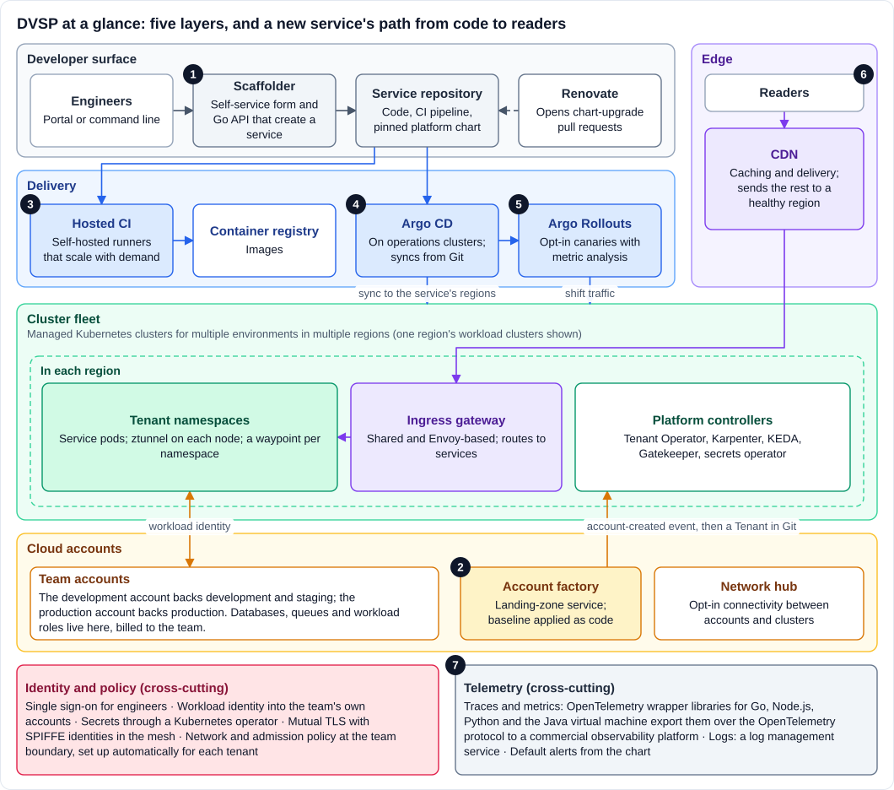
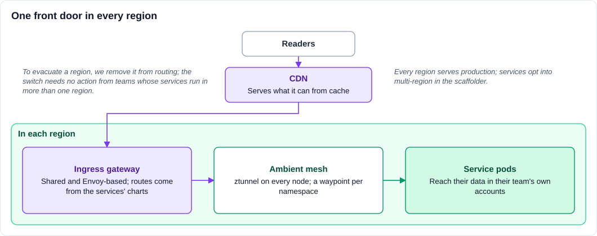

import CNCFProjectCard from '@site/src/components/CNCFProjectCard';

> Submitted by The New York Times to the CNCF End User Technical Advisory Board via [cncf/tab#119](https://github.com/cncf/tab/issues/119). Documentation is distributed under [CC BY 4.0](https://creativecommons.org/licenses/by/4.0/).

## Relevant CNCF projects

<CNCFProjectCard name={"Kubernetes"} href={"https://www.cncf.io/projects/kubernetes/"} logo={"/img/cncf-projects/kubernetes-kubernetes-icon-color.svg"} since={"2021"} description={"Managed Kubernetes clusters for multiple environments and regions run our tenants' container workloads. Adoption: Established."} />

<CNCFProjectCard name={"Helm"} href={"https://www.cncf.io/projects/helm/"} logo={"/img/cncf-projects/helm-helm-icon-color.svg"} since={"2021 (cluster add-ons); 2023 (the platform chart)"} description={"One versioned platform chart is the contract between a service and the platform; services pin a version per environment and set only what differs from the defaults. Adoption: Established."} />

<CNCFProjectCard name={"Argo"} href={"https://www.cncf.io/projects/argo/"} logo={"/img/cncf-projects/argo-argo-icon-color.svg"} since={"2022"} description={"Argo CD syncs tenants' services from Git; Argo Rollouts canaries services that opt in. Adoption: Established (Argo CD); Developing (Argo Rollouts, opt-in per service)."} />

<CNCFProjectCard name={"Cilium"} href={"https://www.cncf.io/projects/cilium/"} logo={"/img/cncf-projects/cilium-cilium_icon-color.svg"} since={"2021"} description={"The cluster network plugin and kube-proxy replacement; its network policy enforces the boundary between teams. Adoption: Established."} />

<CNCFProjectCard name={"Istio"} href={"https://www.cncf.io/projects/istio/"} logo={"/img/cncf-projects/istio-istio-icon-color.svg"} since={"2021 (sidecars); 2026 (ambient mode)"} description={"Mutual TLS, identity-based authorization and application-layer traffic shaping between services, now moving from sidecars to ambient mode. In ambient mode, a proxy on each node (ztunnel) carries traffic over mutual TLS, and a shared proxy per namespace (a waypoint) applies request-level policy. Adoption: Established."} />

<CNCFProjectCard name={"Envoy"} href={"https://www.cncf.io/projects/envoy/"} logo={"/img/cncf-projects/envoy-envoy-icon-color.svg"} since={"2021"} description={"The data plane of our shared ingress gateway and of the mesh's waypoint proxies. Adoption: Established."} />

<CNCFProjectCard name={"kgateway"} href={"https://www.cncf.io/projects/kgateway/"} logo={"/img/cncf-projects/kgateway-kgateway-icon-color.svg"} since={"2026"} description={"The Gateway API implementation that our ingress gateway is moving to. Adoption: Emerging."} />

<CNCFProjectCard name={"KEDA"} href={"https://www.cncf.io/projects/keda/"} logo={"/img/cncf-projects/keda-keda-icon-color.svg"} since={"2024"} description={"Event-driven autoscaling alongside the Horizontal Pod Autoscaler: pre-scaling on news publication events, plus scheduled and queue-based scaling. Adoption: Developing (opt-in per service)."} />

<CNCFProjectCard name={"Karpenter"} logo={"/img/cncf-projects/kubernetes-kubernetes-icon-color.svg"} description={"Provisions the nodes for our clusters, mixing spot and on-demand capacity. Karpenter is a subproject of the Kubernetes special interest group (SIG) for autoscaling. Adoption: Established."} />

<CNCFProjectCard name={"Open Policy Agent (OPA)"} href={"https://www.cncf.io/projects/open-policy-agent-opa/"} logo={"/img/cncf-projects/open-policy-agent-opa-icon-color.svg"} since={"2022"} description={"Admission policy written in Rego, the Open Policy Agent policy language. Adoption: Established."} />

<CNCFProjectCard name={"OpenTelemetry"} href={"https://www.cncf.io/projects/opentelemetry/"} logo={"/img/cncf-projects/opentelemetry-opentelemetry-icon-color.svg"} since={"2022"} description={"Shared wrapper libraries for Go, Node.js, Python and the Java virtual machine configure the SDKs, propagate W3C trace context and baggage, and export over the OpenTelemetry protocol to a commercial observability platform. Adoption: Developing (required for backend services; logs travel a separate path)."} />

<CNCFProjectCard name={"SPIFFE"} href={"https://www.cncf.io/projects/spiffe/"} logo={"/img/cncf-projects/spiffe-spiffe-icon-color.svg"} description={"The identity format for services, in their mesh certificates. Adoption: Developing."} />

<CNCFProjectCard name={"Kubebuilder"} logo={"/img/cncf-projects/kubernetes-kubernetes-icon-color.svg"} since={"2021"} description={"The framework behind our Tenant Operator, which turns a `Tenant` resource in Git into namespaces, access and policies. Adoption: Established."} />

## Other projects

| Component | Role in the architecture |
|---|---|
| A managed Kubernetes service | Runs the control planes of our cluster fleet |
| The cloud provider's landing zone and network hub | The baseline behind our account factory; opt-in connectivity between accounts and clusters |
| A secrets manager and its Kubernetes operator | Secrets for services |
| A commercial management plane for Istio | Runs Istio ambient mode across clusters |
| A hosted CI service | Builds and tests services on self-hosted runners that scale with demand |
| Container and artifact registries | Container images; the registry that hosts the platform chart |
| Renovate, Kustomize | Chart-upgrade pull requests; rendering the chart in each repository, with room for deliberate patches |
| An infrastructure-as-code tool and a managed build service | Cluster, add-on and account baselines, and the pipelines that apply them |
| Managed message queues | Queues that KEDA scales consumers on |
| A commercial observability platform and a log management service | Metrics, traces, alerts and canary analysis; logs |
| A content delivery network (CDN) | Caching and delivery in front of the ingress gateway |

## Synopsis

The New York Times runs most of its container-based services on DVSP, a shared internal developer platform.
Its core is a fleet of managed Kubernetes clusters for multiple environments and regions in the public cloud, which more than a hundred teams share as tenants.
Five patterns carry the design:

- A tenant has two borders: namespaces on the shared clusters, and the team's own cloud accounts.
- Trust comes from workload identity, not network location.
- One versioned Helm chart is the contract between a service and the platform.
- Public traffic to the platform's services enters through one gateway per region, so we can evacuate a region by changing routing.
- Services scale independently, and can pre-scale on news publication events, because traffic can multiply within minutes, faster than new nodes start.

**Names used on this page.**
DVSP (originally the Delivery Engineering Shared Platform) is our name for the platform this page describes.
We call the other systems on this page by what they do: the cluster fleet, the account factory, the shared ingress gateway, and the scaffolder, a self-service form and API that creates new services.
We name the open-source projects we use, except a few tools that one of our providers owns; we describe those, and commercial products and cloud services, by their category.

| At a glance | |
|---|---|
| Clusters | Managed Kubernetes clusters for multiple environments, in multiple regions |
| Tenants | More than a hundred teams, each with a development and a production cloud account |
| Mesh | About 630 shared waypoint proxies in place of about 10,000 sidecars |
| Cluster upgrades | Three to four cycles a year, each touching every cluster and more than ten components |

## Organization

The New York Times is dedicated to helping people understand the world through on-the-ground, expert and deeply reported independent journalism.
It has more than 13 million subscribers and about 6,000 employees.

Developer Platforms builds and runs the shared platforms that our engineering teams use, including DVSP, the multi-tenant platform this page describes.
DVSP began in 2021, when a technology strategy in Product Engineering set out to centralize the capabilities that most engineering teams need.
Before it, teams ran on a platform-as-a-service and team-owned Kubernetes clusters at a second cloud provider, a single shared account at our main provider, and CI pipelines that each team built for itself.
Teams ran hundreds of small, differently configured Kubernetes clusters, each of which needed its own upgrades and security fixes.
Product teams spent a significant share of their time on that infrastructure rather than on their products.

## Teams and platform team topology

### Platform team topology: internal

Five teams in Developer Platforms build and run the platform, and each offers its layer as a service:

- **Engagements** builds the scaffolder and partners with product teams on migrations.
  In Team Topologies terms it is both an enabling team and a platform team, and it is senior-heavy, because its engineers have to understand and contribute to every other layer.
- **Cloud Engineering** owns the account factory and the cluster fleet.
- **Application Delivery** owns CI (a hosted CI service and our self-hosted runners), continuous delivery (Argo CD and Argo Rollouts) and the progressive-delivery paved path.
- **Edge Platforms** owns the CDN integration and the shared ingress gateway.
- **Site Reliability Engineering** owns observability standards and tooling, load testing and cost visibility.

The platform chart is maintained InnerSource-style, so that one team owns it while other teams can still contribute.
Since 2024 a core team has owned the chart and its release process, and the teams behind specific features maintain those parts through code-owner rules in the chart's repository; for example, Application Delivery maintains the Argo Rollouts templates.

### Platform team topology: external

Product teams are stream-aligned and own their services, including on-call.
The platform meets them in three modes:

- **As a service, by default.**
  The scaffolder, the chart, documentation, office hours and a changelog channel.
  An AI assistant in our support channel answers from the platform documentation and routes the rest using a map of which team owns which component.
- **Collaboration, for migrations.**
  From 2023, Engagements paired its migration leads with engineers from the product team.
  The aim was to teach rather than to carry: we partnered until a team was confident enough to self-serve.
  Our focus is now shifting from migrating services to deepening what the platform offers.
- **Facilitation, for platform changes.**
  When a platform change needs action from tenants, such as a chart upgrade for the mesh migration, the owning team publishes a runbook and helps the teams that fall behind.

## Architecture overview & Goals

### Goals

1. **Run one fleet instead of hundreds of clusters.**
   Upgrades, security fixes and add-ons happen once, done by the team that is best at them.
2. **Isolate teams without giving each a cluster.**
   A team keeps control of its own cloud resources, permissions and bill.
3. **Make the right way the easy way.**
   A new service gets source control, build and deploy pipelines, a runtime, secrets, routing and telemetry without a ticket, and can opt into canary releases in its chart values.
4. **Be ready for the news.**
   Absorb breaking-news spikes, and keep serving when a cloud region degrades.
5. **Change the platform under running services.**
   Evolve the mesh, the ingress or autoscaling without a migration project per service.
   Changes that need a newer chart reach a service only when its team merges the upgrade; see [What has not worked well?](#what-has-not-worked-well).
6. **Build on widely adopted components.**
   Prefer projects with broad ecosystems, and open standards such as OpenTelemetry and the Gateway API, to bespoke tooling.

### Architecture overview

[](./images/dvsp-overview.svg)

The platform has five layers, and a new service passes through all of them on its way to readers.
The numbers match the figure.

1. **Scaffold.**
   An engineer fills in the scaffolder's form.
   The scaffolder's API, a Go service that runs on the platform, creates the repository from templates: application code with OpenTelemetry already wired, a CI pipeline definition, per-environment Kustomize files that pin a version of the platform chart, and the service's routes.
2. **Account and tenant.**
   A team that is new to the platform requests a development and a production cloud account through a self-service form.
   The account factory creates them with a baseline applied, and the account-created event leads to a `Tenant` for the team in Git, which the Tenant Operator applies in every environment of the fleet.
3. **Build.**
   The hosted CI service builds the container image and pushes it to a container registry.
4. **Deploy.**
   Argo CD, on separate operations clusters, renders the chart from the repository and syncs it to the workload clusters of each environment, in each of the service's regions.
5. **Release.**
   For services that turn on progressive delivery, Argo Rollouts shifts traffic to the new version in steps through Istio and aborts on its own when metric analysis fails.
6. **Serve.**
   A reader's request passes through the CDN to the ingress gateway in a healthy region, and on through the ambient mesh to the service, which reaches its data in its team's own cloud account.
7. **Observe.**
   Traces and metrics flow through the OpenTelemetry wrapper libraries to a commercial observability platform, logs go to a log management service, and the chart can create a default set of alerts.

### Key design principles

- **Two borders per tenant.**
  A tenant is a set of namespaces on shared clusters plus the team's own cloud accounts.
  We accept cross-account plumbing and multi-account debugging in exchange for isolation, and for a cost boundary that already existed.
- **Identity, not network location.**
  On shared nodes an IP address does not identify a team, so authorization uses workload identity, with network policy as an outer fence.
  The price is a longer chain of trust that every new cluster, account and service has to join; the platform sets that up automatically, but the chain is harder to debug across accounts.
- **Build features into the runtime, not into language libraries.**
  When we add a capability such as service-to-service authentication, we favor the mesh or the cluster over language-specific SDKs, so every service gets it the same way.
  Telemetry and baggage propagation are the exception: they live in shared wrapper libraries for four languages.
- **Keep the burden on teams low.**
  Since the account factory's 2020 design we have aimed to reduce the work it takes a team to get started and to keep going: accounts, tenants, extra namespaces and routes are self-service, and a new account creates its tenant without a ticket.
- **One front door per region, evacuation by routing.**
  Public traffic to the platform's services enters through the shared ingress gateway, which gives us one place for routing and regional evacuation, and also one shared failure domain to plan capacity for.
  Every region serves production, and we evacuate a region by routing, not by restoring clusters, which protects only the services deployed to more than one region.
- **The chart is the contract, and silence is the default.**
  Teams declare only what differs from the paved path.
  The platform changes the defaults, and teams pick them up by moving to a newer chart version.
- **Everything is a pull request.**
  Tenants, extra namespaces, mesh enablement per namespace and cluster changes are Git changes; for changes such as mesh enablement, a rollback is a revert.

### Patterns you can reuse

| Pattern | Problem it solves | How we do it | Cost we accept | On other platforms |
|---|---|---|---|---|
| Two-border tenancy | Isolation and cost attribution without a cluster per team | Namespaces on shared clusters plus each team's cloud accounts | Cross-account plumbing and debugging | An account, project or subscription per team, depending on the cloud |
| Identity, not network location | Shared nodes make IP addresses meaningless as identity | Cloud workload identity for pods, a secrets operator, SPIFFE identities in the mesh; network policy as a fence | A long chain of trust to automate and debug | Workload identity on most managed Kubernetes services; elsewhere, SPIRE (the SPIFFE runtime) |
| Event-driven onboarding | Tenants without tickets | An account-created event creates a `Tenant` in Git; a controller reconciles it | A controller to own and upgrade | Any account or project factory that emits lifecycle events |
| A versioned contract chart | Platform defaults without per-repository YAML | One chart in a registry, pinned per environment, with Renovate pull requests | Platform changes wait for tenant merges | Any Helm or Kustomize base plus an update bot |
| Evacuate by routing | Regional failure without restoring clusters | A CDN in front of a gateway in each region; a region is evacuated by removing it from routing | A shared failure domain; protects only multi-region services | Any CDN or DNS steering in front of per-region gateways, with one place to drain a region |
| Pre-scale on a business signal | Spikes that outrun node start-up | Services pre-scale through KEDA on news publication events, ahead of the traffic | Per-service configuration to verify; coordination with node consolidation | Any event source plus KEDA |
| Baggage-routed pull-request environments | Testing multi-service changes without full copies | W3C baggage propagated by shared libraries; the mesh routes per service | Every service must propagate baggage | Any mesh with header-based routing |

This design assumes the tenants are teams in one company.
If tenants are mutually untrusted, or regulation requires dedicated capacity, give those tenants dedicated node pools or clusters.

### Tenancy: two borders

[](./images/dvsp-tenant-model.svg)

A tenant is a team.
It has a pair of cloud accounts from our account factory, and one or more namespaces in each environment of the fleet.
The development account backs the development and staging clusters; the production account backs production.
When we designed the shared clusters in 2021, our security architects framed tenancy as two borders: the Kubernetes namespace and the cloud account.

Compute is shared: tenant pods are bin-packed onto large nodes.
What a team owns stays in its accounts: its databases, buckets and queues, its cloud roles, and its bill.
Teams keep control of the network and policy settings for their own cloud resources and manage them directly, which was a requirement from the start.
In the terms of the Kubernetes [multi-tenancy guidance](https://kubernetes.io/docs/concepts/security/multi-tenancy/), this is soft multi-tenancy: the tenants are teams in one company.
The platform enforces the team boundary in the network and in runtime identity, and the separate accounts carry that boundary into the cloud.
Because pods from different teams share nodes, node and pod hardening matter as much to this isolation as the boundary itself.

**Onboarding is an event, not a ticket.**
Creating an account in the account factory emits an account-created event, and the platform responds by creating the team's `Tenant` in Git, which is deployed to every environment.
Our Tenant Operator, a Kubebuilder controller, turns each `Tenant` into the team's namespaces, access and policies, so a new team's isolation and access are set up automatically.
Tenants add namespaces themselves by creating a `Space`, and new namespaces inherit the tenant's configuration.
Our first design mapped each tenant to exactly one namespace; more namespaces per tenant turned out to be one of the features beta tenants asked for most.

**Cost follows the borders.**
Anything in a tenant's accounts is billed to those accounts, so that part of cost attribution needs no tagging at all.
We reallocate shared cluster capacity and platform overhead to tenants by CPU usage, keyed on a tenant label on their pods, and report idle capacity as its own line.

### Identity instead of network location

When we designed the shared clusters, our security architects pointed out a consequence of bin-packing: because a node runs pods from many teams, a node's network address says nothing about which team sent a request.
So every path is authenticated by identity, and the platform sets up each team's identities and access automatically when it creates the tenant.
The mechanisms are:

- single sign-on for engineers;
- cloud workload identity, so pods can use only their own team's cloud roles;
- a secrets manager, with a Kubernetes operator; and
- mesh certificates that carry SPIFFE identities.

Network policy is an outer fence around each team, not a way to authenticate a caller.

### The paved path as a versioned contract

[](./images/dvsp-delivery.svg)

**The scaffolder** is the front door.
Its form and its API, a Go service that runs on the platform, create the repository and wiring described in step 1.

**The platform chart** is the contract between a service and the platform.
It is published to our artifact registry and follows semantic versioning.
Each repository pins a chart version per environment in a Kustomize `helmCharts` entry.
Kustomize pulls the chart, renders it and applies any patch the repository defines, which is the escape hatch when a team needs something the chart does not offer.
The values file is designed so that silence means the default:

```yaml
# Illustrative values for one service in one environment.
# Anything not set here takes the platform default.
global: {}            # service, team and environment identity (abridged)
image:
  repository: <registry>/example-api
  tag: "1.42.0"
autoscaling:
  enabled: true
  minReplicas: 3
  maxReplicas: 30
rollout:
  enabled: true       # Argo Rollouts (default strategy: one 100% step)
  analysis:
    enabled: true     # metric analysis; a failed run aborts the canary
```

From values like these the chart renders the Deployment or Rollout, the Service, the autoscaling resources, the ingress route, a PodDisruptionBudget and alerts.
Its defaults include three replicas spread across availability zones.
Renovate opens chart-upgrade pull requests in the repositories that the scaffolder created, and teams review and merge them like any other dependency update.

**Argo CD** runs hub-and-spoke, on dedicated operations clusters apart from the workload clusters it deploys to.
Tenant applications are generated from ApplicationSets, and we recommend automated sync with pruning and self-healing.
Argo CD is not in the request path: if it stopped, running services would keep serving, and only changes would stop.

**Argo Rollouts** is opt-in.
With `rollout.enabled`, the chart renders a Rollout that references the service's Deployment and shifts weights on an Istio VirtualService between the stable and canary versions.
With analysis enabled, the Rollout checks error rate, restarts and out-of-memory kills in our observability platform, and a failing run aborts the canary without a human.
The default strategy is a single 100% step.
Some teams now treat a canary that aborts on its own as a stronger release gate than a pre-deploy test, because it checks the deployed pods under real traffic.

**Pull-request environments** can run each open pull request as an ephemeral deployment in the development cluster.
A request can also carry a W3C `baggage` header whose entries name services and their open pull requests, and the VirtualService rules that the chart renders route each named service in the call chain to its pull request's version.
This works because the OpenTelemetry wrapper libraries propagate baggage on every outbound call, so testing a change that spans three services does not need a copy of everything else.
Routing of this kind is limited to the development environment.

**CI** runs on a hosted CI service, with self-hosted runners that scale with demand.

### One front door in every region

[](./images/dvsp-traffic.svg)

The CDN serves what it can from cache and sends requests for the platform's services to the shared ingress gateway in a healthy region.
The gateway is Envoy-based.
It routes each request and hands it to the ambient mesh.
Teams define their routes alongside their service, through the chart, so routing changes ship with the service instead of through a ticket to the edge team.
The gateway is moving to the Kubernetes Gateway API, implemented by kgateway.

**Every region serves production.**
Services opt into multi-region in the scaffolder and then run in more than one region.
To evacuate a region we remove it from the gateway's routing; we do not restore clusters.
An evacuation protects only the services that run in more than one region, and it moves requests, not data: such a service needs its own plan for its data, which lives in its team's accounts.

### Scaling ahead of breaking news

A breaking-news alert can multiply a service's traffic within minutes, faster than new nodes can start.
Each service scales independently on its own load, and services that opt in also pre-scale on news publication events, so that capacity starts arriving before readers do.
Pre-scaling runs alongside each service's own autoscaling, so a service that is already busy keeps scaling on its traffic.
What operating this taught us about coordinating autoscalers is under [What has not worked well?](#what-has-not-worked-well).

### Keeping every cluster current

Keeping the fleet current is recurring work.
We run three to four upgrade cycles a year, so that every cluster stays on a Kubernetes version that the managed service supports.
Each cycle touches the control plane, the node images and more than ten components, among them Cilium, Istio, Karpenter, KEDA, Gatekeeper, the Argo projects, the secrets operator, the storage drivers and our own operators.

Each pull request changes one cluster, so it has one blast radius.
A cycle upgrades compatibility add-ons first, then the control plane, then node images.
It rolls out in phases across our environments, soaks between phases as needed, and changes are announced in the platform changelog in advance.
Cluster add-ons are applied per cluster by pipelines, in dependency order: cloud resources through an infrastructure-as-code tool, then Helm charts, then Kustomize overlays.

An AI coding agent now researches each upgrade, cross-checks each component's compatibility and opens the pull requests.
It never merges, and nothing changes until an engineer approves.

## Can you expand on why you are using those projects/services?

These are our main choices, with the alternatives we weighed at the time.

| Decision | What we chose | Alternatives we weighed | Why |
|---|---|---|---|
| Cloud (2021) | One public cloud provider | Designing for several clouds from the start | Consolidating on one provider let us centralize shared capabilities in one place; we recorded it as a strategy bet in 2022 |
| Clusters (2021) | A small fleet of shared managed Kubernetes clusters | A cluster per team, as before | Hundreds of small clusters each needed its own upgrades and security fixes |
| Tenant border (2020–2021) | A pair of cloud accounts per team, from an account factory | One large shared account; unmanaged accounts per team; a separate isolation unit per team, as we used on our second cloud | In the shared account every boundary needed central review; unmanaged accounts and the earlier script-based baselines were hard to keep consistent |
| Tenant controller (2021–2022) | An in-house Tenant Operator built with Kubebuilder | Tenants generated from infrastructure-as-code templates; the Operator Framework or plain client-go; Capsule and kiosk, which the design listed as references | Per-tenant policy changes as tenants come and go, so it needs continuous reconciliation; Kubebuilder's documentation, its home in Kubernetes SIG API Machinery and the team's familiarity |
| Runtime (2022) | Kubernetes first, stateless services first | Serverless as the primary runtime | Kubernetes is widely adopted, with a broad ecosystem |
| Cluster networking (2021) | Cilium, replacing the cloud provider's default network plugin | Calico, which our security team tested first | Lower network-policy latency, finer-grained policy, better pod-network performance and friendlier documentation |
| Pod addressing (2022) | Pod addresses that route in the cloud network, from a secondary range | An overlay network | A managed control plane that runs outside the cluster network cannot reach overlay pod addresses, which breaks admission webhooks |
| Admission policy (2021) | Gatekeeper (Open Policy Agent) | Kyverno | Policy in Rego |
| GitOps (2022) | Argo CD | Flux; push-based deploys from CI; a cloud deployment service, raised in review | Push-based deploys gave CI no view of declared state or drift; Argo CD's web interface, single sign-on and notifications suited a platform shared by many teams; we kept to Kubernetes-native tools |
| Progressive delivery (2022) | Argo Rollouts | Flagger, alongside Flux | A Rollout looks like a Deployment, shapes traffic through Istio and runs analysis against our metrics |
| Application contract (2023–2024) | A versioned Helm chart, rendered through Kustomize | Full per-repository YAML from templates; a higher-level application model such as the Open Application Model with KubeVela, or Knative | Per-repository YAML asked every team to learn a large Kubernetes configuration, and platform features meant hand-editing overlays in each repository; the chart moves that configuration under the platform team's care |
| Breaking-news capacity (2025) | Pre-scaling on news publication events with KEDA | Reactive autoscaling only | Spikes outrun node start-up |
| Mesh (2025) | Istio ambient mode, managed through a commercial management plane | Staying on sidecars; open-source Istio managed in-house | Sidecars took about a third of production CPU; managing open-source Istio ourselves would have meant building multi-cluster management, policy and observability tooling |

**What ambient mode changed.**
By 2025 the sidecar model meant a proxy in every pod, two proxy hops on every call, and the lifecycle of thousands of sidecars to manage.
After production moved to ambient mode, the mesh's share of production CPU fell from about a third to under 7%, about 10,000 sidecars were replaced by about 630 shared waypoints, and about 9,400 cores were freed.
In a staging load test at 100,000 requests per second, 99th-percentile latency on a high-throughput GraphQL service was about 191 ms with sidecars and 3 to 5 ms with ambient mode after tuning.
The CPU gains come from ambient mode itself, which removes per-pod proxies; we run it with a commercial management plane.

## What has worked well?

- **The two borders scaled.**
  Creating an account creates a tenant, teams manage their own cloud resources, and cost for anything in a team's own account falls out of account boundaries.
- **Paved-path services move faster.**
  Services on a current chart received the ambient mesh largely through a chart upgrade.
- **Regional evacuation at the edge.**
  Removing a region from the gateway's routing moves reader traffic to another region without restoring clusters, and the switch itself needs no action from teams whose services run in more than one region.
- **Capacity ahead of the spike.**
  Pre-scaling on news publication events usually starts capacity arriving before readers do, without each team having to watch the news.
- **GitOps for the platform itself.**
  Reverting the pull request that enables ambient mode for a namespace rolls it back in one to three minutes, plus a rolling restart.
- **Agents as platform users.**
  An AI agent drafts our cluster-upgrade pull requests, and engineers review and merge them.

## What has not worked well?

- **Platform changes still ride on tenant merges.**
  The chart freed teams from YAML but not from the platform's release train.
  Some platform-wide changes, such as the move to ambient mode, need every service to adopt a newer chart.
  Automated upgrade pull requests shorten the wait but cannot remove it: each one still needs a merge, and the bot that opens them is one more dependency to watch.
- **The values file became the new YAML.**
  One chart now covers ingress, mesh, autoscaling, rollouts, secrets, alerts, pull-request environments and cron jobs, so its values file is a large surface to learn.
  Anything the chart does not expose, such as label selectors that it fixes in place, needs a Kustomize patch.
- **Ambient mode is sensitive to node density.**
  The node-level proxy (ztunnel) carries the traffic of every pod in the mesh on its node, so its headroom has to be sized for the densest node pool, not the average one.
  We pin node sizes, reserve capacity for node agents and keep pods off a new node until the mesh is ready on it, and we roll ambient mode out in stages, with a soak between them.
- **Autoscalers do not coordinate on their own.**
  KEDA scales in seconds, while Karpenter consolidates nodes on its own, slower cycle, and neither knows about the other, so consolidation can move pods that KEDA has just added.
  Karpenter plans consolidation on pod requests, not on usage, so pods whose requests sit far below their limits can make busy nodes look underused and invite consolidation under load.
  Two levers help: requests closer to what pods use at peak, and limits on consolidation while services are pre-scaled.
  Scaling back in after pre-scaling needs pods to drain cleanly, so the chart adds a pre-stop delay.
- **Shared clusters need shared manners.**
  Tenant PodDisruptionBudgets can stall node drains, so a drain needs a bound on how long it can wait; Karpenter's node pools have a termination grace period for this.
  Cluster-wide agents, such as observability daemons, grow with how often tenants' pods and services come and go, not with traffic.
  And the node autoscaler has to start on a cold cluster, so it resolves DNS through the cloud network's resolver rather than through cluster DNS, which runs on nodes it provisions.
- **Migration help does not scale on its own.**
  Migration partnerships did more than anything else to drive adoption, but they take a lot of senior engineers' time, and services with structural blockers, such as stateful data or serverless designs, need new paved paths more than migration help.
- **Shared ownership erodes.**
  Shared libraries that everyone is meant to own tend to end up with no owner.
  For the chart, a core team and feature maintainers keep ownership explicit.

## What sort of "glue" have you had to develop?

| Glue | What it does |
|---|---|
| Tenant Operator (Kubebuilder) | Turns `Tenant` and `Space` resources into namespaces, access and policies |
| Account-to-tenant automation | Creates and updates tenants from account-factory lifecycle events |
| Tenant API and command-line tool | A service for tenant metadata, and a command-line tool for engineers |
| Self-service ingress routing | Routes that ship with the service, through the chart |
| The scaffolder | A self-service form and a Go API that create new services |
| The platform and alert charts, and their Renovate configuration | The service contract, default alerts, and the pull requests that keep services current |
| OpenTelemetry wrapper libraries | SDK configuration and context propagation for Go, Node.js, Python and the Java virtual machine |
| Upgrade agent | Drafts per-cluster upgrade pull requests for engineers to review |
| Cost allocation rules | Reallocate shared cluster cost to tenants by CPU usage |

## How did the Architecture Evolve

### Journey

- **2020: accounts first.**
  An account factory built on the cloud provider's landing-zone service, with an account per team and opt-in connectivity, designed to replace a single shared cloud account.
- **2021: strategy and the first clusters.**
  We defined the two borders with our security architects and built the first clusters (development, staging and production, in multiple regions) with Cilium, Istio and an Envoy-based ingress.
- **2022: bets and stepping stones.**
  We recorded our strategy bets (one cloud, Kubernetes first, a central ingress, accounts as tenancy, stateless services first), built interim shared clusters on our second cloud as a stepping stone, replaced template-generated tenants with the Tenant Operator, chose Argo CD and Argo Rollouts, and put the shared ingress gateway into production.
- **2023: general availability.**
  DVSP became generally available in March, with the scaffolder, build and deploy pipelines, Argo CD, the cluster fleet and the shared ingress gateway.
- **2024: the chart becomes the contract.**
  The platform chart became the default for new services, with an InnerSource ownership model.
- **2025: safer releases and faster scaling.**
  Canary analysis became a chart feature, services began pre-scaling on news publication events, and OpenTelemetry became a required standard.
- **2026: ambient mode and consolidation.**
  We began moving the fleet to Istio ambient mode, and began shifting our focus from migrating services to deepening what the platform offers.

### Key lessons

- **Draw the tenant border where ownership already is.**
  Accounts already carried access, network boundaries and budgets, so making them half of the tenant border gave us isolation and cost attribution with little extra machinery.
  Agree that border in writing with your security team before you write a controller.
- **On shared nodes, network location is not a trustworthy signal.**
  Design workload identity first, and treat network policy as a fence, not as authentication.
- **A paved path is a product with a release train.**
  Decide early how a platform change will reach running services without a pull request in every repository, or every platform change becomes a migration campaign.
- **Operations after launch are the platform.**
  Staff for upgrades before features, keep each change to one cluster, and let automation write the pull requests while people approve them.
- **Test infrastructure changes at production density.**
  Node-level components such as ztunnel can behave differently on the densest nodes, so test at the density of your busiest workloads.
- **Couple autoscalers on purpose.**
  Pod autoscaling, node autoscaling and consolidation form one control system; tuned separately, they fight.
- **A shared front door needs burst isolation.**
  Know which traffic can arrive at full rate with no ramp-up, and give it a buffered path.
- **Opt-in resilience protects only the services that opt in.**
  Make the multi-region choice explicit when a service is created, because a regional evacuation helps only the services that run in more than one region.
- **Plan for replacements.**
  When a component is replaced, as ambient mode is replacing sidecars, the replacement needs a way to reach services that are already running.

### What's next for your architecture?

- **The Gateway API at the front door.**
  Finish moving the shared ingress gateway to the Gateway API on kgateway.
- **Paved paths beyond containers.**
  Serverless and data-store paved paths, for the services that a container platform does not fit.
- **Platform-wide pre-scaling.**
  A platform-wide scale-up control alongside per-service pre-scaling.
- **Fewer custom components.**
  Evaluate more of the cloud provider's managed options for nodes, networking and account provisioning, weighing fewer components to upgrade against Cilium's flow visibility and application-layer policy.
